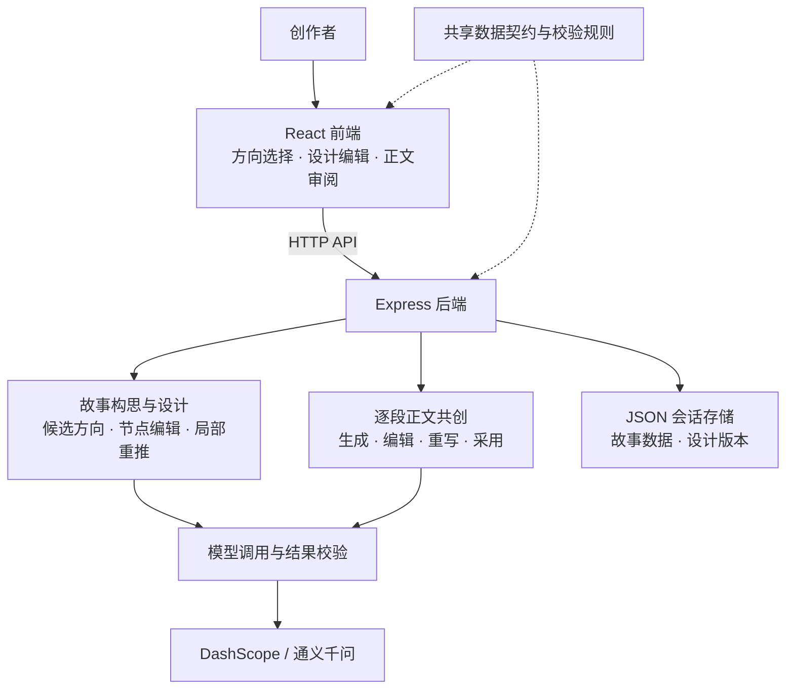

# 青柠时光创作平台

一个让创作者保留决定权的 AI 故事共创平台。从一句想法出发，选择故事走向、调整故事设计，再按确认的主线逐段写成故事。创作者可以编辑设计节点、直接修改正文或提出局部重写意见，由自己决定采用哪些内容。

## 目标用户与实际痛点

面向有故事灵感，但需要帮助梳理情节、推进写作的创作者。

- **灵感难以展开**：有了人物、事件或场景，却不知道从哪里制造冲突、让故事继续发展。
- **整篇生成难以参与**：一次生成完整故事，往往只能事后修改，难以在情节定型前介入。
- **局部调整不够方便**：只想修改某个情节或段落，却需要反复描述上下文、重新生成内容。

## 核心功能

- **灵感构思**：根据想法和创作要求生成候选故事方向，帮助找到值得展开的冲突与困境。
- **故事设计**：在写作前查看故事的开端、发展与收束，编辑节点或重新生成局部设计。
- **逐段共创**：按确认的主线展开正文，支持手动编辑和带意见的局部重写。
- **作者确认**：由作者审阅和采用设计、正文，控制故事走向与表达。
- **版本切换**：在本次创作中查看和切换故事设计版本，比较不同方案。

## 使用流程

1. **创意方向**：输入故事想法，选择故事感觉、戏剧力量并补充创作要求。
2. **故事走向选择**：比较三种候选方向，查看和调整遇到的难处、眼前的选择及后续变化，选定故事走向。
3. **故事设计**：审阅和编辑故事节点，局部重新推演，由作者决定采用哪些提案并确认主线。
4. **写成故事**：按确认的设计逐段生成正文，支持直接编辑、填写意见局部重写，审阅采用后继续。
5. **完整故事**：全部段落采用后，查看整理完成的正文，自行复制保存。

## 技术栈

- **前端**：React 18、TypeScript、Vite、原生 CSS、Lucide 图标。
- **后端**：Node.js、Express 5、TypeScript。
- **模型接入**：通过 DashScope 兼容接口调用通义千问，默认使用 `qwen-plus`。
- **数据存储**：后端 JSON 文件保存故事会话与设计版本。
- **数据契约**：前后端共享 TypeScript 类型与运行时校验规则。
- **测试**：Node.js 内置测试框架，覆盖故事设计、编辑重推、正文生成与审阅等逻辑。

## 架构



前端承载创作者的选择、编辑与确认操作；后端组织故事设计和正文生成流程，调用模型并校验返回结果，保存故事会话与设计版本。

## 本地运行

建议使用 Node.js 22 LTS 与 npm，并准备可用的 DashScope API Key。

以下命令适用于 Windows PowerShell。macOS、Linux 可将 `npm.cmd` 替换为 `npm`。

### 安装依赖

```powershell
git clone https://github.com/fengnin/qingningcreate.git
cd qingningcreate
cd backend
npm.cmd ci
cd ../frontend
npm.cmd ci
cd ..
```

### 配置模型

```powershell
Copy-Item backend/.env.example backend/.env
```

macOS、Linux 使用：

```bash
cp backend/.env.example backend/.env
```

编辑 `backend/.env`，填入自己的密钥：

```dotenv
DASHSCOPE_API_KEY=your-dashscope-api-key
QWEN_MODEL=qwen-plus
PORT=8787
```

真实密钥仅放在后端，不能写入前端代码或上传到仓库。

### 启动服务

打开两个终端，均从项目根目录 `qingningcreate` 开始。

在第一个终端启动后端：

```powershell
cd backend
npm.cmd run dev
```

在第二个终端启动前端：

```powershell
cd frontend
npm.cmd run dev
```

打开前端终端显示的地址，默认是 `http://localhost:5173`。开发服务器会将 `/api` 请求代理到 `http://127.0.0.1:8787`。

访问 `http://127.0.0.1:8787/health`，返回 `ok: true`、`configured: true` 表示后端已启动并读取到密钥。实际能否调用千问，还需在页面输入想法并生成一次验证。

## 常用配置

正常使用只需填写 `DASHSCOPE_API_KEY`，其余配置可保持默认。以下配置位于 `backend/.env`，修改后需重启后端。

| 变量 | 默认值 | 用途 |
| --- | --- | --- |
| `DASHSCOPE_API_KEY` | 无 | 必填：自己的 DashScope API 密钥 |
| `QWEN_MODEL` | `qwen-plus` | 通常保持默认：模型名称 |
| `PORT` | `8787` | 通常保持默认：后端监听端口 |
| `DASHSCOPE_BASE_URL` | `https://dashscope.aliyuncs.com/compatible-mode/v1/chat/completions` | 按需配置：自定义模型请求的完整地址，需包含 `/chat/completions` |
| `STORY_SESSION_STORE_PATH` | `backend/data/story-sessions.json` | 按需配置：后端会话文件路径；自定义相对路径以启动后端时的工作目录为基准 |

配置示例见 [`backend/.env.example`](backend/.env.example)。

如修改后端端口，可在 `frontend/.env.local` 中设置开发代理目标，然后重启前端：

```dotenv
VITE_STORY_API_TARGET=http://127.0.0.1:9193
```

该代理配置用于本地开发，正式部署时由 Web 服务器配置 API 转发。

## 测试

从项目根目录执行后端回归测试：

```powershell
cd backend
npm.cmd test
```

测试命令会先编译后端，再运行 Node.js 测试。真实千问生成效果需另行通过实际创作流程验证。

## 构建与部署

从项目根目录分别构建前后端：

```powershell
cd backend
npm.cmd run build
cd ../frontend
npm.cmd run build
```

构建完成后，在 `backend` 目录执行 `npm.cmd start` 启动后端。请先安装后端依赖，并配置该目录下的 `.env`。

前端静态产物位于 `frontend/dist`，由 Web 服务器托管，并将 `/api` 请求转发到后端。前端代码使用相对 API 地址，建议前端与 API 使用同一域名。

部署时保留项目根目录下的 `shared/`，以及 `backend/dist`、`backend/package.json`、依赖和配置。后端编译产物仍引用 `shared/` 中的运行时模块，不能只复制 `backend/dist` 单独运行。

本地可在 `frontend` 目录执行 `npm.cmd run preview` 预览构建结果，同时保持后端运行；预览命令不作为正式部署服务。

## 项目结构

```text
backend/
  src/            API、模型调用、故事设计、正文共创与回归测试
  data/           运行时生成的会话数据，不提交 Git
  .env.example    后端配置模板
frontend/
  src/
    components/   页面与交互组件
    story/        创作状态、操作逻辑与 API 请求
    styles.css    界面样式
  vite.config.ts  Vite 构建与开发代理配置
shared/           前后端共享的类型契约与运行时校验规则
```

## 数据保存

故事会话默认写入运行后端的机器上的 `backend/data/story-sessions.json`，也可通过 `STORY_SESSION_STORE_PATH` 指定保存位置。部署时请保留该目录的写入权限；需要保留的数据应自行备份。

重新打开或刷新页面会开始新的创作，不会恢复当前进度，也不会删除后端已保存的会话数据。请在离开前自行保存需要保留的正文；设计版本切换仅在本次页面创作中提供。

当前不提供跨设备同步或历史故事列表。调用模型时，相关创作材料会发送至配置的模型服务。
